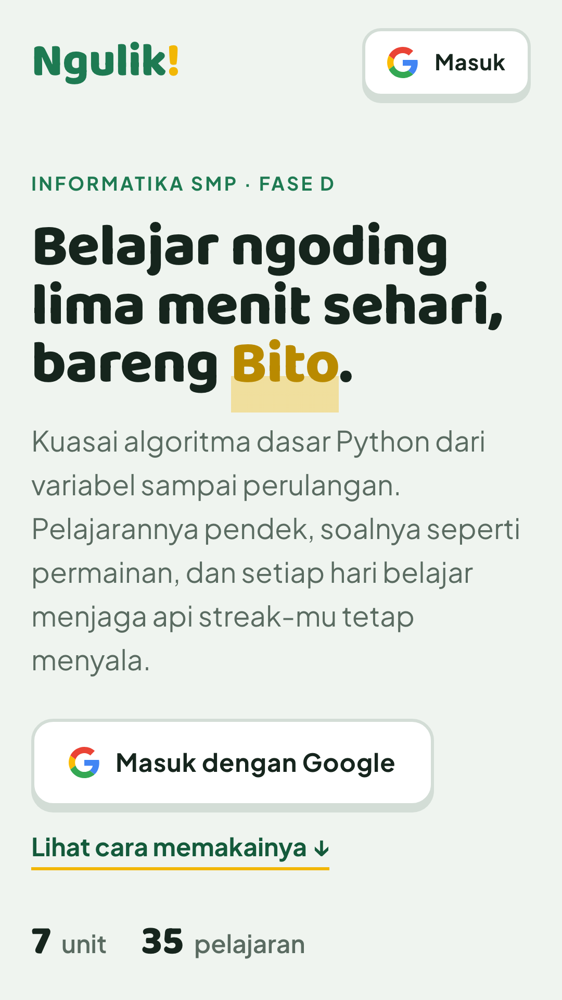
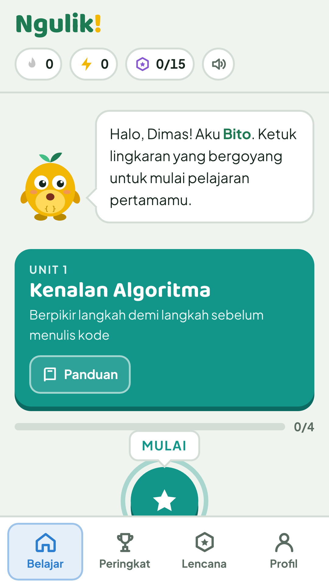
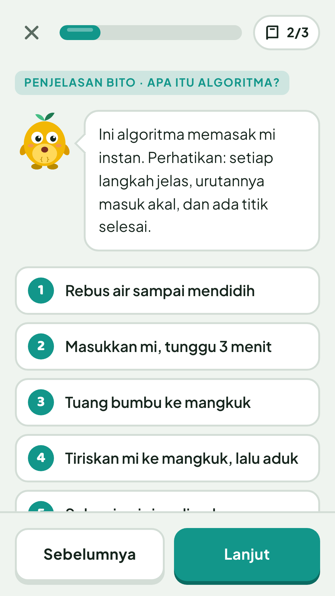
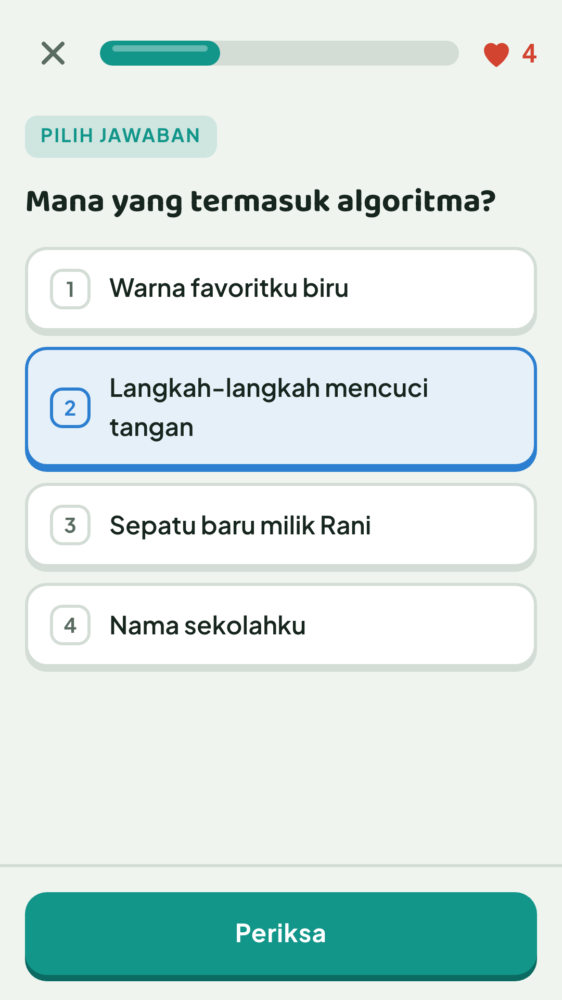
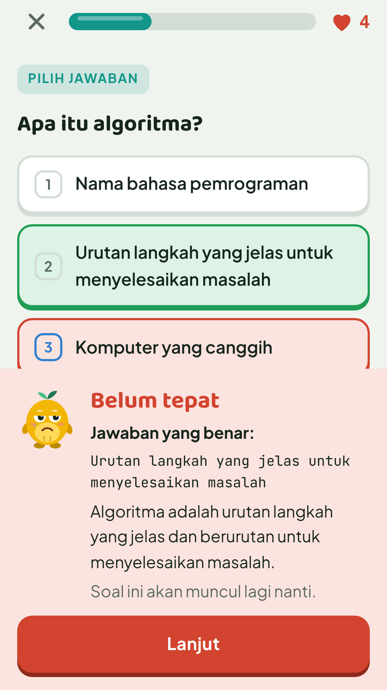
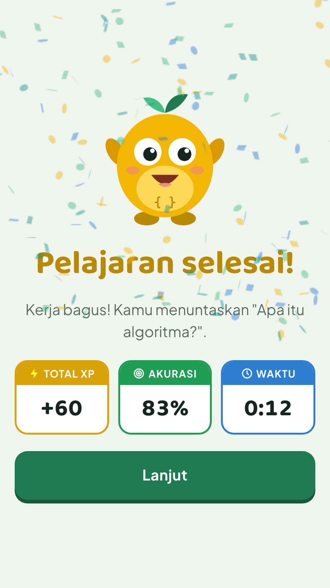
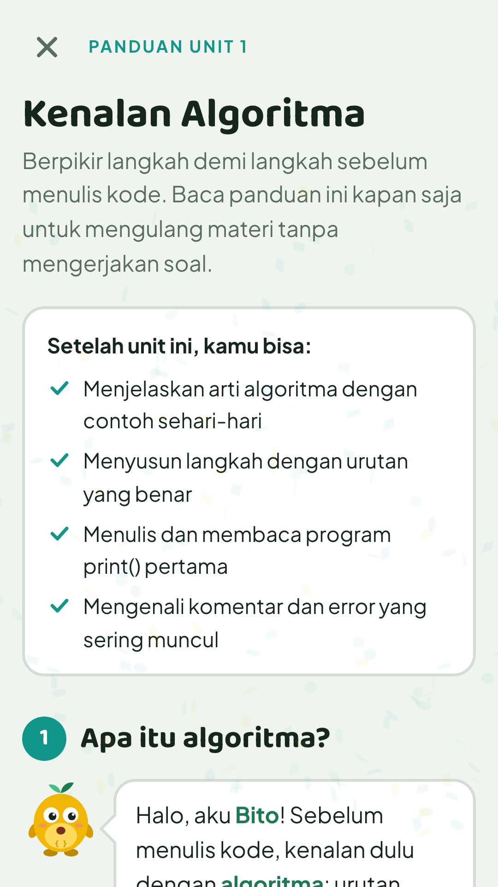
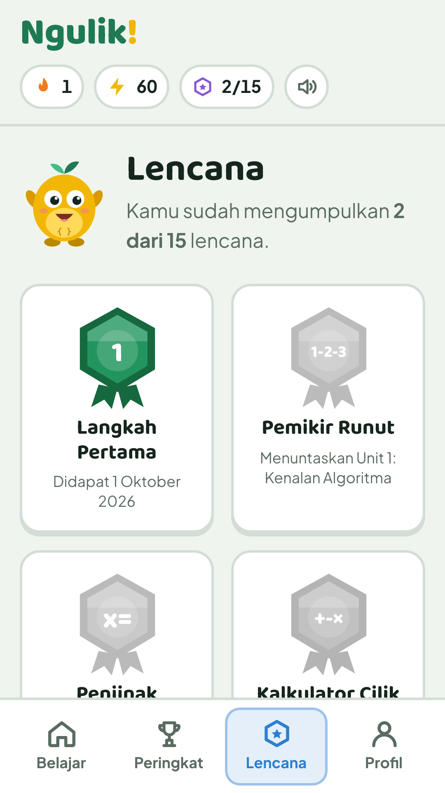

# Panduan Penggunaan Ngulik!

Panduan singkat untuk siswa. Isi yang sama tampil di landing page, bagian **Cara memakai Ngulik!**.

> **Untuk pembuat panduan:** screenshot disimpan di folder `public/tutorial/` dengan nama file persis seperti di bawah. Ukuran disarankan 1080 × 1920 px (rasio 9:16, tampilan HP), format PNG. Selama file belum ada, landing page menampilkan kotak penanda berisi nama file yang dibutuhkan.

---

## Langkah 1. Masuk ke Ngulik!

*Gambar 1. Landing page dengan tombol "Masuk dengan Google" (atau "Mulai belajar" pada mode tamu).*

1. Buka alamat Ngulik! di browser.
2. Ketuk **Masuk dengan Google** dan pilih akunmu.
3. Kalau tombol Google tidak muncul, ketuk **Mulai belajar**, isi nama panggilan, lalu ketuk **Ayo mulai**. Progres mode tamu hanya tersimpan di browser itu.

**Ambil screenshot:** halaman paling atas landing page sebelum masuk.

## Langkah 2. Kenali Peta Belajar

*Gambar 2. Peta Belajar: lingkaran pelajaran yang bergoyang dan bar atas berisi streak, XP, dan lencana.*

- Lingkaran yang bergoyang adalah pelajaran berikutnya.
- Bar atas: **api** = streak harian, **petir** = total XP, **medali** = jumlah lencana.
- Unit berikutnya terbuka setelah unit sebelumnya tuntas.

**Ambil screenshot:** halaman Belajar setelah masuk, dengan Bito menyapa di atas.

## Langkah 3. Dengarkan Bito

*Gambar 3. Kartu penjelasan Bito dengan contoh kode dan tombol "Lanjut".*

1. Ketuk lingkaran pelajaran, lalu mulai.
2. Baca 2–3 kartu penjelasan berisi contoh kode dan keluarannya.
3. Ketuk **Lanjut** untuk pindah kartu, dan **Siap, ayo latihan!** di kartu terakhir.

**Ambil screenshot:** salah satu kartu penjelasan yang memuat contoh kode.

## Langkah 4. Jawab soal latihan

*Gambar 4. Layar soal: bar kemajuan, jumlah nyawa, pertanyaan, pilihan jawaban, dan tombol "Periksa".*

- Setiap pelajaran punya **6 soal** dan kamu punya **5 nyawa**.
- Enam bentuk soal: pilihan ganda, tebak keluaran, isi bagian kosong, susun blok kode, ketik jawaban, dan pasangkan.
- Pilih atau isi jawabanmu, lalu ketuk **Periksa** (atau tekan Enter di komputer).

**Ambil screenshot:** satu soal dengan jawaban sudah dipilih, sehingga tombol **Periksa** aktif.

## Langkah 5. Baca hasilnya

*Gambar 5. Umpan balik setelah menjawab: kotak hijau (benar) atau merah (salah) beserta penjelasan Bito.*

- Jawaban benar: muncul penjelasan singkat.
- Jawaban salah: nyawa berkurang satu, dan soalnya muncul lagi di akhir sampai kamu paham.
- Ketuk **Lanjut** untuk soal berikutnya.

**Ambil screenshot:** umpan balik jawaban salah (kotak merah), karena paling informatif. Boleh ditambah satu untuk jawaban benar.

## Langkah 6. Kumpulkan XP dan jaga streak

*Gambar 6. Layar selesai pelajaran: perolehan XP, streak bertambah, dan lencana baru.*

| Sumber XP | Jumlah |
| --- | --- |
| Soal benar di percobaan pertama | 10 XP |
| Pertama kali menuntaskan pelajaran | +10 XP |
| Pelajaran tanpa salah | +5 XP |

- Streak bertambah sekali sehari saat kamu menuntaskan minimal satu pelajaran, dan putus bila sehari terlewat.
- Lencana baru muncul otomatis saat syaratnya terpenuhi.

**Ambil screenshot:** layar perayaan setelah pelajaran selesai.

## Langkah 7. Ulangi materi lewat Panduan

*Gambar 7. Tombol "Panduan" pada kepala unit di peta dan halaman ringkasan materinya.*

Ketuk **Panduan** di kepala tiap unit pada peta untuk membaca ringkasan materi tanpa soal.

**Ambil screenshot:** halaman Panduan salah satu unit (atau kepala unit yang menunjukkan tombolnya).

## Langkah 8. Peringkat, Lencana, dan Profil

*Gambar 8. Menu bawah (Belajar, Peringkat, Lencana, Profil) dan salah satu halamannya.*

- **Peringkat**: bandingkan XP dan streak dengan teman sekelas.
- **Lencana**: 15 pencapaian yang bisa dikumpulkan.
- **Profil**: ringkasan progres, masuk dengan Google, **Keluar**, atau hapus progres.

**Ambil screenshot:** halaman Lencana atau Peringkat, dengan menu bawah terlihat.

---

## Daftar file screenshot

| No. | Nama file | Isi |
| --- | --- | --- |
| 1 | `langkah-1-masuk.png` | Landing page + tombol masuk |
| 2 | `langkah-2-peta.png` | Peta Belajar |
| 3 | `langkah-3-materi.png` | Kartu penjelasan Bito |
| 4 | `langkah-4-soal.png` | Layar soal dengan jawaban terpilih |
| 5 | `langkah-5-hasil.png` | Umpan balik jawaban |
| 6 | `langkah-6-selesai.png` | Layar selesai pelajaran |
| 7 | `langkah-7-panduan.png` | Tombol/halaman Panduan |
| 8 | `langkah-8-menu.png` | Menu bawah + Lencana/Peringkat |

## Kalau ada masalah

- **Tombol Masuk dengan Google tidak muncul**: aplikasi berjalan di mode tamu karena konfigurasi Firebase belum diisi. Lihat bagian Firebase di [README.md](README.md).
- **Login Google gagal dengan `auth/unauthorized-domain`**: tambahkan domain situs di Firebase Console → Authentication → Settings → Authorized domains.
- **Progres hilang**: mode tamu menyimpan progres di browser. Membersihkan data browser atau berganti perangkat menghapusnya. Masuk dengan Google agar progres aman.
